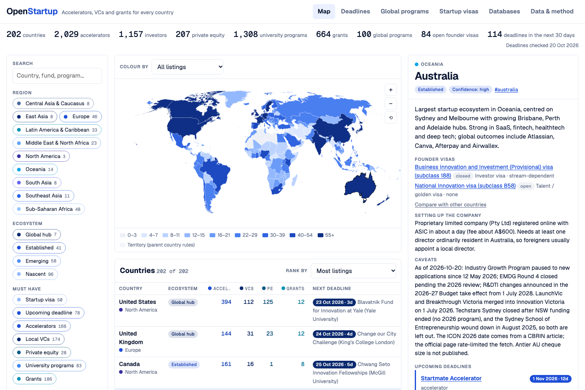
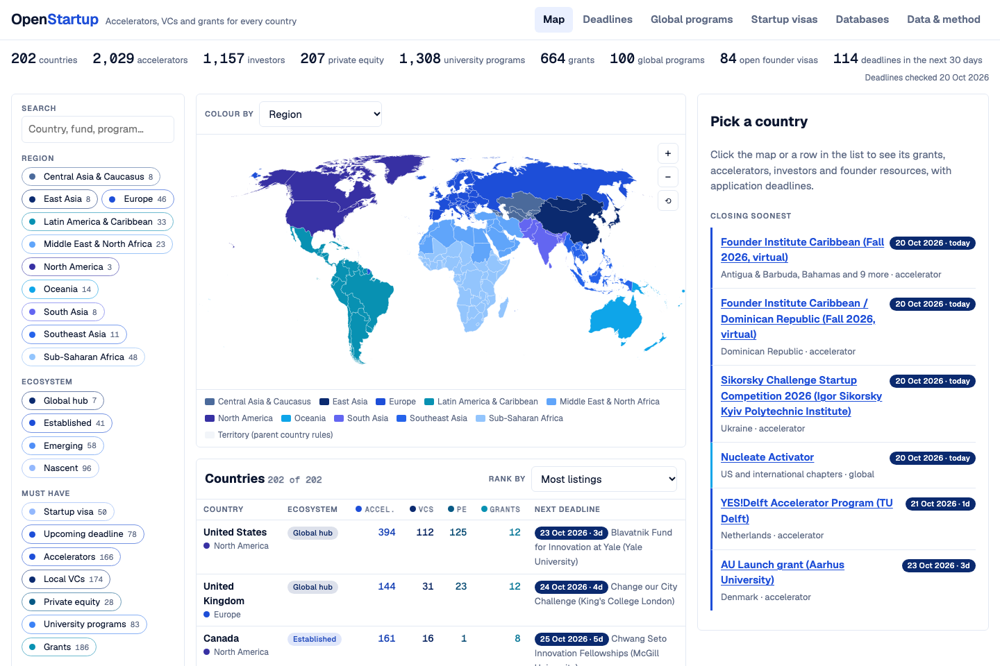
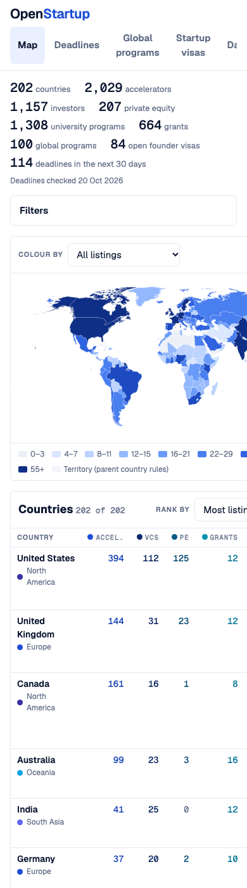
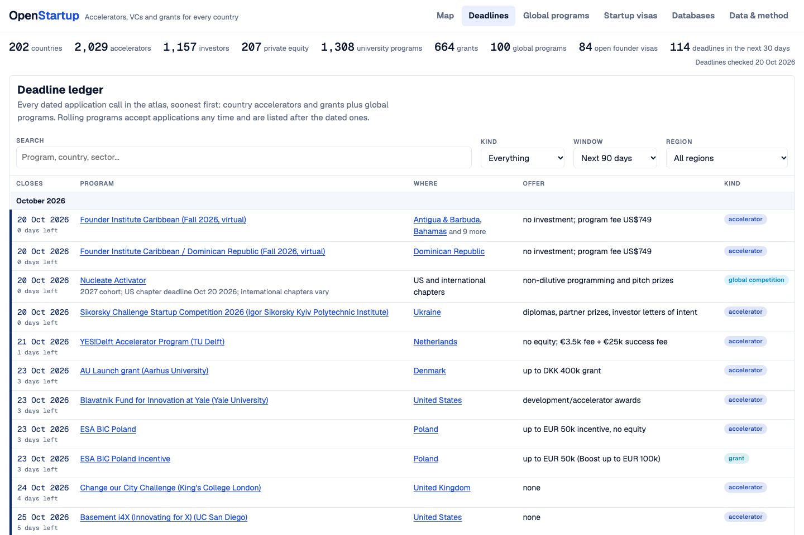

<div align="center">

# 🚀 OpenStartup · Startup Funding Atlas

### Every startup accelerator, VC, government grant and founder resource, for every country, on one map, with application deadlines.

**202 countries · 2,029 accelerators (incl. 1,308 university programs) · 1,157 VCs · 207 private equity firms · 664 grants · 1,174 local resources · 100 global programs · 77 databases · deadlines checked 20 October 2026**

[](https://openstartup-qz7.pages.dev/)
[](https://openstartup-qz7.pages.dev/data/openstartup.xlsx)
[](https://openstartup-qz7.pages.dev/data/openstartup.json)

[](#-at-a-glance)
[](#-at-a-glance)
[](#-at-a-glance)
[](#-what-you-can-do)
[](#-at-a-glance)
[](#-at-a-glance)
[](#-closing-soon)
[](https://openstartup-qz7.pages.dev/)
[](#%EF%B8%8F-run-it-yourself)
[](https://d3js.org/)
[](LICENSE)
[](#-contributing)

<br>

<a href="https://openstartup-qz7.pages.dev/"></a>

</div>

---

## ✨ What you can do

| | Feature | Details |
|---|---|---|
| 🔢 | **Clickable totals** | Every headline number opens its list: countries jumps to the ranked list; accelerators, investors, private equity and grants each open a searchable worldwide table (filter by region, sort by country, name or deadline, click a country to open its dossier); global programs and the 30-day deadline count open their views. |
| 🗺️ | **World map** | Colour every country by all listings, region, ecosystem tier, accelerators, VCs, grants, upcoming deadlines or startup visa. Counts run from pale to deep blue in nine steps. Zoom, pan and tap any country. |
| 🎨 | **Shades of blue** | A white page where every distinction is a different blue: each region, ecosystem tier and listing type (teal-blue grants, royal-blue accelerators, navy investors, indigo resources, sky-blue global programs) has its own shade. Deadlines darken as they get closer: navy within 7 days, royal blue within 30, lighter blues further out, indigo for rolling, grey for closed. |
| 📅 | **Deadline ledger** | Every dated application call in the atlas (country accelerators and grants plus global programs), soonest first, grouped by month. Window: 30 days, 90 days, 12 months, all dated, or rolling only. A program listed for many countries (EIC Accelerator, YC, Techstars) shows once with every country named. |
| 📄 | **Country dossier** | Ecosystem summary, startup visa, how to set up the company, caveats, upcoming deadlines, then tabs for grants, accelerators, VCs, private equity and resources, each with its deadline badge and official link, plus sources. |
| 🌍 | **Global programs** | 100 accelerators, fellowships, competitions and perks open to founders anywhere: YC, Techstars, a16z speedrun, Antler, EF, Google for Startups, the EIC Accelerator, Thiel, Emergent Ventures, cloud credits and more. |
| 🛂 | **Startup visas** | A comparison of 87 founder visa routes in 61 countries: 30 countries with an open startup visa and 60 with any open founder route. Dedicated startup visas (UK Innovator Founder, Netherlands, Estonia, Ireland STEP, Japan, Singapore EntrePass, Thailand SMART-S…), entrepreneur and self-employment permits, talent and golden visas, investor visas and digital-nomad permits, each with who it's for, endorsement, money needed, length, path to permanent residence, family, fee, processing time and the government's own page. Filter by type, status, region, no minimum investment, permanent residence or family. Paused and closed routes (Canada's Start-up Visa, Australia's BIIP, New Zealand's Entrepreneur Work Visa) stay listed. The map's **Founder visas** view grades every country. Open it with [`#visas`](https://openstartup-qz7.pages.dev/#visas). |
| 🎓 | **University programs** | 1,308 accelerators, incubators, venture funds, fellowships and pitch competitions at 309 universities in 83 countries: every Australian university we could find (UNSW Founders, INCUBATE at the University of Sydney, MAP, UQ Ventures…), the QS top 200 in the US and Canada (MIT, Harvard's i-lab and OTD accelerators, StartX at Stanford, SkyDeck…), and leading universities across Europe, Asia, the Middle East, Africa and Latin America. Each shows the university, its QS World University Rankings 2026 position where verified, who can apply and the next deadline. Click the figure at the top or use [`#university-programs`](https://openstartup-qz7.pages.dev/#university-programs). |
| 🏦 | **Private equity** | A separate list of 207 private equity firms in 28 countries from Wikipedia's [List of private equity firms](https://en.wikipedia.org/wiki/List_of_private_equity_firms), with headquarters, founding year and assets or five-year fundraising (PEI 300) where Wikipedia gives them. It has its own dossier tab, list column, filter and map view. |
| 🧰 | **Databases** | 77 cross-border tools: OpenVC, Airtree's open-source lists, Crunchbase, Dealroom, Signal, Grants.gov, the EU Funding & Tenders portal, Stripe Atlas, e-Residency, and others. |
| 🎛️ | **Stackable filters** | Region, ecosystem tier, and must-haves (startup visa, upcoming deadline, accelerators, local VCs, grants) with live counts, plus free-text search across every program and fund name. |
| 📱 | **Works on phones** | Filters fold away on small screens. Your filters are remembered in your browser. |

🔗 Link straight to a country with its name as the anchor, e.g. [`#australia`](https://openstartup-qz7.pages.dev/#australia), [`#nigeria`](https://openstartup-qz7.pages.dev/#nigeria) or [`#united-kingdom`](https://openstartup-qz7.pages.dev/#united-kingdom). Open a view with [`#deadlines`](https://openstartup-qz7.pages.dev/#deadlines), [`#global`](https://openstartup-qz7.pages.dev/#global) or [`#databases`](https://openstartup-qz7.pages.dev/#databases), or a worldwide list with [`#accelerators`](https://openstartup-qz7.pages.dev/#accelerators), [`#investors`](https://openstartup-qz7.pages.dev/#investors), [`#private-equity`](https://openstartup-qz7.pages.dev/#private-equity) or [`#grants`](https://openstartup-qz7.pages.dev/#grants).

---

## 📸 Screenshots

<table>
<tr>
<td width="62%"><b>🗺️ Coloured by region</b><br></td>
<td width="38%" rowspan="2"><b>📱 On a phone</b><br></td>
</tr>
<tr>
<td><b>📅 Deadline ledger</b><br></td>
</tr>
</table>

> 🔁 Screenshots are generated by `python3 make_screenshots.py`.

---

## 📈 At a glance

| Region | Countries | Accelerators | VCs | Private equity | Grants | Resources |
|---|---:|---:|---:|---:|---:|---:|
| 🌍 Europe | 46 | 247 | 336 | 52 | 228 | 274 |
| 🌍 Sub-Saharan Africa | 48 | 141 | 198 | 1 | 151 | 246 |
| 🌎 Latin America & Caribbean | 33 | 127 | 125 | 1 | 67 | 213 |
| 🌎 North America | 3 | 33 | 129 | 126 | 24 | 24 |
| 🌍 Middle East & North Africa | 23 | 54 | 90 | 4 | 50 | 57 |
| 🌏 East Asia | 8 | 50 | 94 | 16 | 36 | 59 |
| 🌏 Oceania | 14 | 23 | 50 | 3 | 35 | 132 |
| 🌏 Southeast Asia | 11 | 53 | 68 | 4 | 35 | 67 |
| 🌏 South Asia | 8 | 29 | 36 | 0 | 23 | 55 |
| 🌏 Central Asia & Caucasus | 8 | 29 | 31 | 0 | 15 | 47 |
| | **202** | **786** | **1,157** | **207** | **664** | **1,174** |

**🏆 Deepest ecosystems in the atlas** (all listings): 🇺🇸 United States 279 · 🇬🇧 United Kingdom 96 · 🇨🇳 China 67 · 🇦🇺 Australia 63 · 🇮🇳 India 63 · 🇯🇵 Japan 59 · 🇸🇬 Singapore 59 · 🇩🇪 Germany 50 · 🇨🇦 Canada 45 · 🇫🇷 France 45

**🏦 Most private equity firms:** 🇺🇸 United States 125 · 🇬🇧 United Kingdom 23 · 🇨🇳 China 10 · Denmark 4 · 🇭🇰 Hong Kong 4 · Norway 4

**🏛️ Most government grants:** 🇦🇺 Australia 16 · 🇮🇳 India 12 · 🇬🇧 UK 12 · 🇺🇸 US 12 · 🇩🇪 Germany 10 · 🇫🇷 France 9

**🧭 Ecosystem tiers:** 7 global hubs · 41 established · 58 emerging · 96 nascent. **34** countries have a startup or founder visa.

---

## ⏰ Closing soon

From the 20 October 2026 check. The [live ledger](https://openstartup-qz7.pages.dev/#deadlines) always counts down from today.

| Closes | Program | Where |
|---|---|---|
| 23 Oct 2026 | ESA BIC Poland | 🇵🇱 Poland |
| 26 Oct 2026 | Impact Launchpad | 🇸🇮 Slovenia |
| 28 Oct 2026 | NASA SBIR/STTR | 🇺🇸 United States |
| 30 Oct 2026 | EBRD Star Venture | 🇲🇩 Moldova, 🇺🇦 Ukraine |
| 30 Oct 2026 | Activate Fellowship | 🌍 Global |
| 30 Oct 2026 | Malta Enterprise Start-up Finance | 🇲🇹 Malta |
| 31 Oct 2026 | BIRAC E-YUVA | 🇮🇳 India |
| 1 Nov 2026 | Startmate Summer '27 (A$120k for 8%) | 🇦🇺 Australia, 🇳🇿 New Zealand |
| 1 Nov 2026 | a16z speedrun SR008 (up to US$1M) | 🌍 Global |
| 2 Nov 2026 | Y Combinator Winter 2027 | 🌍 Global |
| 2 Nov 2026 | Startup Wise Guys | 🇪🇪 Estonia and the Baltics |
| 4 Nov 2026 | EIC Accelerator (full proposals) | 🇪🇺 39 EU and associated countries |
| 4 Nov 2026 | NSF SBIR/STTR Phase I | 🇺🇸 United States |
| 6 Nov 2026 | MIT Solve 2027 Global Challenges | 🌍 Global |
| 13 Nov 2026 | ELEVATE NxT | 🇮🇳 Karnataka, India |
| 15 Nov 2026 | IoBM SSK Incubation Cohort 6 | 🇵🇰 Karachi, Pakistan |
| 16 Nov 2026 | Innovation Fund Smart Start | 🇷🇸 Serbia |
| 17 Nov 2026 | NEDO GX_UPP | 🇯🇵 Japan |
| 18 Nov 2026 | Techstars Spring 2027 (NYC, Boston, London, Anywhere…) | 🌍 Global |
| 18 Nov 2026 | Innovate UK Efficient AI | 🇬🇧 United Kingdom |
| 26 Nov 2026 | NBB Innovation Programme (Bahrain FinTech Bay) | 🇧🇭 Bahrain |

---

## 🗂️ What's in the dataset

All files are in [`data/`](data/) and served from the live site under `/data/`.

| File | Rows | What it holds |
|---|---:|---|
| `countries.csv` | 202 | Region, ecosystem tier, counts, startup visa, company setup, summary, caveats, confidence, sources |
| `accelerators.csv` | 2,029 | Name, city, type, investment terms, sectors, **deadline**, next cohort, status, URL; university programs also carry university, kind, who can apply and QS rank |
| `vcs.csv` | 1,157 | Name, city, stage, cheque size, assets under management, sectors, type (VC, CVC, angel network, government fund, venture debt), URL, source |
| `pe.csv` | 207 | Private equity firms: name, city, assets or capital raised, founding year, URL, source |
| `grants.csv` | 664 | Name, agency, amount, max in US$, eligibility, **deadline**, status, URL |
| `resources.csv` | 1,174 | Agencies, startup associations, hubs, communities, events, legal and tax help |
| `visas.csv` | 87 | Founder visa routes: country, name, type, status, who it's for, endorsement, money needed, length, renewal, path to permanent residence, family, processing, fee, URL, verified date, notes |
| `global_programs.csv` | 100 | Cross-border accelerators, fellowships, competitions and perks with deadlines |
| `global_resources.csv` | 77 | Cross-border investor databases, grant finders, ecosystem reports, incorporation services |
| `openstartup.json` | | Everything above in one file |
| `openstartup.xlsx` | | The same data as a workbook with filters, frozen headers and a tier heat map |

**📅 Deadline format.** `YYYY-MM-DD` is the next published deadline on or after 20 Oct 2026. `last: YYYY-MM-DD` is the most recent past deadline when no new one is published. Otherwise the field says `rolling`, gives the usual pattern (e.g. `annual, usually March`), or says `unknown`. Dates are never guessed.

---

## 🔬 How it was researched

| Step | What happened |
|---|---|
| 1️⃣ Schema | One schema for every country ([`research/SCHEMA.md`](research/SCHEMA.md)) with coverage targets by ecosystem tier |
| 2️⃣ Regional research | 15 research agents worked through regional batches ([`research/batches.json`](research/batches.json)), checking each entity on its official site and recording the next deadline |
| 3️⃣ Global layer | One agent covered cross-border programs and databases (`research/global/`) |
| 4️⃣ Merge & validate | `build.py` drops entries without names, rejects malformed URLs, removes duplicates, and lists problems in `research/build_problems.txt` |
| 5️⃣ Wikipedia lists | Firms on Wikipedia's [venture capital](https://en.wikipedia.org/wiki/List_of_venture_capital_firms) and [private equity](https://en.wikipedia.org/wiki/List_of_private_equity_firms) lists that were not already in the atlas were added to their home country (`research/wikipedia/`). Websites come from Wikidata or the article infobox; firms marked defunct, without a website, or whose site failed a live check were left out and are listed under `skipped`. A firm on both lists stays under VCs. |
| 🎓 University programs | Five agents covered the QS top universities by region (`research/universities/`, schema in its `SCHEMA.md`), opening each program page. QS ranks are kept only where read on a QS page; others are blank. Dates whose page gave no year are marked "year inferred". |
| 🛂 Startup visas | Two agents checked founder visa routes against government immigration pages (`research/visas/`, schema in its `SCHEMA.md`). Where a site blocked automated access, the next most official page was used and the notes say so. Countries with no route recorded were not all researched in depth. |
| 6️⃣ Gap-fill | A second pass on 36 thin emerging ecosystems (Gulf states, Jordan, Lebanon, Tunisia, Morocco, Cyprus, Malta, Hungary, the Baltics, the Caucasus, Bangladesh, Pakistan, Sri Lanka, Peru, Uruguay, Paraguay, Guatemala and others), written as patches in [`research/patches/`](research/patches/) that `build.py` applies on top of the first pass. |
| 7️⃣ Link check | `check_links.py` opens all 3,000+ URLs; dead links are fixed or removed, and the results are in `research/link_report.json`. |
| 8️⃣ Spot checks | Conflicts between agents checked against the official page (e.g. a16z speedrun SR008: 1 Nov 2026) |

**Known gaps.** The research session ran out of web searches early, so later batches verified entities by opening official sites directly rather than by searching. Coverage is strongest for global hubs and established ecosystems and thinnest for small and fragile states: **91 of 202 countries are low confidence**, and many accelerator deadlines say `rolling` or `unknown` because the program publishes no date. Entities whose sites were parked, dead or unverifiable were left out, not guessed. Each country's `notes` say what changed (e.g. Techstars Sydney closed, LaunchVic merged into Innovation Victoria, Canada's Start-up Visa paused, Innovate UK Smart grants closed).

---

## 🛠️ Run it yourself

Needs only **Python 3** (plus `openpyxl` for the Excel workbook). The atlas is a single static HTML file: data and map geometry are embedded, and D3 and TopoJSON load from cdnjs.

```bash
git clone https://github.com/FrozenFishe/openstartup.git
cd openstartup

python3 -m http.server 8734 --directory docs   # → http://localhost:8734
```

**🔄 Rebuild after editing research files:**

```bash
python3 build.py             # research/*.json (+ patches) → data/*, webapp/atlas.html, docs/index.html
python3 check_links.py       # optional: check every URL → research/link_report.json
python3 make_screenshots.py  # README screenshots (macOS + Google Chrome)
```

🚀 **Deploying:** the site is served by Cloudflare Pages from `docs/`:

```bash
npx wrangler pages deploy docs --project-name openstartup --branch main
```

---

## 📁 Repository layout

```text
openstartup/
├── 🐍 build.py                    # merge + validate research → data, atlas, docs
├── 🎨 atlas_template.html         # the atlas page (map, ledger, dossier)
├── 📸 make_screenshots.py         # README screenshots
├── 📊 data/                       # CSV, JSON and Excel outputs
├── 🌐 docs/                       # deployed site (index.html + data/ + screenshots/)
├── 🗺️ webapp/
│   ├── atlas.html                 # same page as an embeddable fragment
│   └── geo/countries-50m.json     # Natural Earth 1:50m (world-atlas@2.0.2)
└── 🔬 research/
    ├── SCHEMA.md · batches.json
    ├── countries/b01…b15_*.json   # per-region research
    ├── global/                    # accelerators.json, resources.json
    ├── wikipedia/                 # vcs.json, pe.json from Wikipedia's firm lists
    ├── universities/              # university accelerators by region
    └── visas/                     # startup and founder visa routes
```

---

## 🤝 Contributing

Found a new deadline, a closed program or a missing fund? 🙌

1. 🐛 **Open an issue** with the country, the entry, the correction and an **official link**.
2. 🔧 **Or send a PR**: add a patch file to `research/patches/` (format in [`research/patches/README.md`](research/patches/README.md)) or edit the country's object in `research/countries/<batch>.json` (shape in `research/SCHEMA.md`), run `python3 build.py`, and commit the result.

---

## ⚠️ Disclaimer

> **This is research, not financial or legal advice.** Deadlines move, programs pause and funds close. Check the official page before you rely on a date or an amount.

---

## 📜 License & credits

- 📜 Code: [MIT](LICENSE). Data: CC BY 4.0, except `research/wikipedia/` and the firms drawn from it, which follow Wikipedia's CC BY-SA 4.0.
- 🌍 Modelled on [OpenCharity](https://github.com/OpenCharity-org/OpenCharity) ([atlas](https://opencharity-org.github.io/OpenCharity/)), whose map approach, country list and screenshot script this project reuses.
- 📚 Extra VCs and the private equity list from Wikipedia's [List of venture capital firms](https://en.wikipedia.org/wiki/List_of_venture_capital_firms) and [List of private equity firms](https://en.wikipedia.org/wiki/List_of_private_equity_firms) (CC BY-SA 4.0), with websites from [Wikidata](https://www.wikidata.org/) (CC0).
- 💡 Resource lists inspired by [OpenVC](https://www.openvc.app/) and [Airtree's Open Source VC](https://www.airtree.vc/open-source-vc-categories/lists-and-databases) lists and databases.
- 🗺️ Map geometry: [Natural Earth](https://www.naturalearthdata.com/) via [world-atlas](https://github.com/topojson/world-atlas) · 📈 [D3](https://d3js.org/) · 🧩 [TopoJSON](https://github.com/topojson/topojson-client)
- 🔤 Type: Geist and Geist Mono (Google Fonts)

<div align="center">

**Made for founders building anywhere in the world.**

⭐ Star the repo if it helped you · 🗺️ [Open the atlas](https://openstartup-qz7.pages.dev/)

</div>
