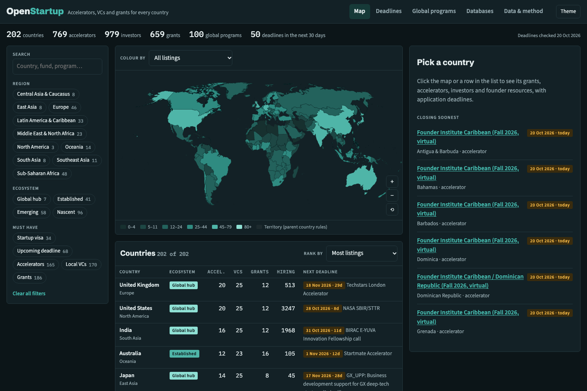

<div align="center">

# 🚀 OpenStartup · Startup Funding Atlas

### Every startup accelerator, VC, government grant and founder resource, for every country, on one map, with application deadlines.

**202 countries · 769 accelerators · 979 investors · 659 grants · 1,165 local resources · 100 global programs · 77 databases · deadlines checked 20 October 2026**

[](https://openstartup-qz7.pages.dev/)
[](https://openstartup-qz7.pages.dev/data/openstartup.xlsx)
[](https://openstartup-qz7.pages.dev/data/openstartup.json)

[](#-at-a-glance)
[](#-at-a-glance)
[](#-at-a-glance)
[](#-at-a-glance)
[](#-closing-soon)
[](https://openstartup-qz7.pages.dev/)
[](#%EF%B8%8F-run-it-yourself)
[](https://d3js.org/)
[](LICENSE)
[](#-contributing)

<br>

<a href="https://openstartup-qz7.pages.dev/"></a>

</div>

---

## ✨ What you can do

| | Feature | Details |
|---|---|---|
| 🗺️ | **World map** | Colour every country by all listings, ecosystem tier, accelerators, VCs, grants, upcoming deadlines, startup visa or **startups hiring on Wellfound**. Zoom, pan and tap any country. |
| 📅 | **Deadline ledger** | Every dated application call in the atlas (country accelerators and grants plus global programs), soonest first, grouped by month. Window: 30 days, 90 days, 12 months, all dated, or rolling only. A program listed for many countries (EIC Accelerator, YC, Techstars) shows once with every country named. |
| 📄 | **Country dossier** | Ecosystem summary, startup visa, how to set up the company, caveats, upcoming deadlines, then tabs for grants, accelerators, investors and resources, each with its deadline badge and official link, plus sources. |
| 🌍 | **Global programs** | 100 accelerators, fellowships, competitions and perks open to founders anywhere: YC, Techstars, a16z speedrun, Antler, EF, Google for Startups, the EIC Accelerator, Thiel, Emergent Ventures, cloud credits and more. |
| 🧰 | **Databases** | 77 cross-border tools: OpenVC, Airtree's open-source lists, Crunchbase, Dealroom, Signal, Grants.gov, the EU Funding & Tenders portal, Stripe Atlas, e-Residency, and others. |
| 🎛️ | **Stackable filters** | Region, ecosystem tier, and must-haves (startup visa, upcoming deadline, accelerators, local VCs, grants) with live counts, plus free-text search across every program and fund name. |
| 📱 | **Phones, light & dark** | Filters fold away on small screens. Follows your system theme or switch with the Theme button. Your filters are remembered in your browser. |

🔗 Link straight to a country with its name as the anchor, e.g. [`#australia`](https://openstartup-qz7.pages.dev/#australia), [`#nigeria`](https://openstartup-qz7.pages.dev/#nigeria) or [`#united-kingdom`](https://openstartup-qz7.pages.dev/#united-kingdom). Open a view with [`#deadlines`](https://openstartup-qz7.pages.dev/#deadlines), [`#global`](https://openstartup-qz7.pages.dev/#global) or [`#databases`](https://openstartup-qz7.pages.dev/#databases).

---

## 📸 Screenshots

<table>
<tr>
<td width="62%"><b>🌙 Dark mode</b><br></td>
<td width="38%" rowspan="2"><b>📱 On a phone</b><br></td>
</tr>
<tr>
<td><b>📅 Deadline ledger</b><br></td>
</tr>
</table>

> 🔁 Screenshots are generated by `python3 make_screenshots.py`.

---

## 📈 At a glance

| Region | Countries | Accelerators | Investors | Grants | Resources |
|---|---:|---:|---:|---:|---:|
| 🌍 Europe | 46 | 247 | 309 | 227 | 273 |
| 🌍 Sub-Saharan Africa | 48 | 140 | 195 | 150 | 244 |
| 🌎 Latin America & Caribbean | 33 | 124 | 110 | 66 | 210 |
| 🌏 East Asia | 8 | 50 | 84 | 36 | 59 |
| 🌏 Southeast Asia | 11 | 53 | 66 | 35 | 67 |
| 🌍 Middle East & North Africa | 23 | 48 | 65 | 49 | 55 |
| 🌎 North America | 3 | 33 | 41 | 24 | 24 |
| 🌏 Oceania | 14 | 22 | 50 | 35 | 132 |
| 🌏 South Asia | 8 | 24 | 33 | 22 | 55 |
| 🌏 Central Asia & Caucasus | 8 | 28 | 26 | 15 | 46 |
| | **202** | **769** | **979** | **659** | **1,165** |

**🏆 Deepest ecosystems in the atlas** (all listings): 🇬🇧 United Kingdom 67 · 🇺🇸 United States 67 · 🇮🇳 India 63 · 🇦🇺 Australia 60 · 🇯🇵 Japan 57 · 🇸🇬 Singapore 54 · 🇨🇳 China 50 · 🇩🇪 Germany 45 · 🇰🇷 South Korea 44 · 🇨🇦 Canada 43

**🏛️ Most government grants:** 🇦🇺 Australia 16 · 🇮🇳 India 12 · 🇬🇧 UK 12 · 🇺🇸 US 12 · 🇩🇪 Germany 10 · 🇫🇷 France 9

**🧭 Ecosystem tiers:** 7 global hubs · 41 established · 58 emerging · 96 nascent. **34** countries have a startup or founder visa.

---

## ⏰ Closing soon

From the 20 October 2026 check. The [live ledger](https://openstartup-qz7.pages.dev/#deadlines) always counts down from today.

| Closes | Program | Where |
|---|---|---|
| 23 Oct 2026 | ESA BIC Poland | 🇵🇱 Poland |
| 26 Oct 2026 | Impact Launchpad | 🇸🇮 Slovenia |
| 28 Oct 2026 | NASA SBIR/STTR | 🇺🇸 United States |
| 30 Oct 2026 | EBRD Star Venture | 🇲🇩 Moldova, 🇺🇦 Ukraine |
| 30 Oct 2026 | Activate Fellowship | 🌍 Global |
| 31 Oct 2026 | BIRAC E-YUVA | 🇮🇳 India |
| 1 Nov 2026 | Startmate Summer '27 (A$120k for 8%) | 🇦🇺 Australia, 🇳🇿 New Zealand |
| 1 Nov 2026 | a16z speedrun SR008 (up to US$1M) | 🌍 Global |
| 2 Nov 2026 | Y Combinator Winter 2027 | 🌍 Global |
| 2 Nov 2026 | Startup Wise Guys | 🇪🇪 Estonia and the Baltics |
| 4 Nov 2026 | EIC Accelerator (full proposals) | 🇪🇺 39 EU and associated countries |
| 4 Nov 2026 | NSF SBIR/STTR Phase I | 🇺🇸 United States |
| 6 Nov 2026 | MIT Solve 2027 Global Challenges | 🌍 Global |
| 13 Nov 2026 | ELEVATE NxT | 🇮🇳 Karnataka, India |
| 16 Nov 2026 | Innovation Fund Smart Start | 🇷🇸 Serbia |
| 17 Nov 2026 | NEDO GX_UPP | 🇯🇵 Japan |
| 18 Nov 2026 | Techstars Spring 2027 (NYC, Boston, London, Anywhere…) | 🌍 Global |
| 18 Nov 2026 | Innovate UK Efficient AI | 🇬🇧 United Kingdom |

---

## 🗂️ What's in the dataset

All files are in [`data/`](data/) and served from the live site under `/data/`.

| File | Rows | What it holds |
|---|---:|---|
| `countries.csv` | 202 | Region, ecosystem tier, counts, Wellfound hiring count, startup visa, company setup, summary, caveats, confidence, sources |
| `accelerators.csv` | 769 | Name, city, type, investment terms, sectors, **deadline**, next cohort, status, URL |
| `vcs.csv` | 979 | Name, city, stage, cheque size, sectors, type (VC, CVC, angel network, government fund, venture debt), URL |
| `grants.csv` | 659 | Name, agency, amount, max in US$, eligibility, **deadline**, status, URL |
| `resources.csv` | 1,165 | Agencies, startup associations, hubs, communities, events, legal and tax help |
| `global_programs.csv` | 100 | Cross-border accelerators, fellowships, competitions and perks with deadlines |
| `global_resources.csv` | 77 | Cross-border investor databases, grant finders, ecosystem reports, incorporation services |
| `openstartup.json` | | Everything above in one file |
| `openstartup.xlsx` | | The same data as a workbook with filters, frozen headers and a tier heat map |

**📅 Deadline format.** `YYYY-MM-DD` is the next published deadline on or after 20 Oct 2026. `last: YYYY-MM-DD` is the most recent past deadline when no new one is published. Otherwise the field says `rolling`, gives the usual pattern (e.g. `annual, usually March`), or says `unknown`. Dates are never guessed.

**💼 Wellfound.** The number of startups hiring in each country comes from Wellfound's public location pages (`wellfound.com/startups/location/<country>`), checked 20 Oct 2026. It counts companies with open roles there, including global companies with a local office, so read it as a hiring signal, not a census of local startups. Canada, South Korea, Pakistan and Georgia have no Wellfound country page, so they show Toronto, Seoul, Karachi and Tbilisi. See [`research/wellfound/`](research/wellfound/).

---

## 🔬 How it was researched

| Step | What happened |
|---|---|
| 1️⃣ Schema | One schema for every country ([`research/SCHEMA.md`](research/SCHEMA.md)) with coverage targets by ecosystem tier |
| 2️⃣ Regional research | 15 research agents worked through regional batches ([`research/batches.json`](research/batches.json)), checking each entity on its official site and recording the next deadline |
| 3️⃣ Global layer | One agent covered cross-border programs and databases (`research/global/`) |
| 4️⃣ Hiring signal | Wellfound location pages for all 202 countries, one request at a time (`research/wellfound/`) |
| 5️⃣ Merge & validate | `build.py` drops entries without names, rejects malformed URLs, removes duplicates, and lists problems in `research/build_problems.txt` |
| 6️⃣ Spot checks | Conflicts between agents checked against the official page (e.g. a16z speedrun SR008: 1 Nov 2026) |

**Known gaps.** The research session ran out of web searches early, so later batches verified entities by opening official sites directly rather than by searching. Coverage is strongest for global hubs and established ecosystems and thinnest for small and fragile states: **93 of 202 countries are low confidence**, and many accelerator deadlines say `rolling` or `unknown` because the program publishes no date. Entities whose sites were parked, dead or unverifiable were left out, not guessed. Each country's `notes` say what changed (e.g. Techstars Sydney closed, LaunchVic merged into Innovation Victoria, Canada's Start-up Visa paused, Innovate UK Smart grants closed).

---

## 🛠️ Run it yourself

Needs only **Python 3** (plus `openpyxl` for the Excel workbook). The atlas is a single static HTML file: data and map geometry are embedded, and D3 and TopoJSON load from cdnjs.

```bash
git clone https://github.com/FrozenFishe/openstartup.git
cd openstartup

python3 -m http.server 8734 --directory docs   # → http://localhost:8734
```

**🔄 Rebuild after editing research files:**

```bash
python3 build.py             # research/*.json → data/*, webapp/atlas.html, docs/index.html
python3 make_screenshots.py  # README screenshots (macOS + Google Chrome)
```

🚀 **Deploying:** the site is served by Cloudflare Pages from `docs/`:

```bash
npx wrangler pages deploy docs --project-name openstartup --branch main
```

---

## 📁 Repository layout

```text
openstartup/
├── 🐍 build.py                    # merge + validate research → data, atlas, docs
├── 🎨 atlas_template.html         # the atlas page (map, ledger, dossier)
├── 📸 make_screenshots.py         # README screenshots
├── 📊 data/                       # CSV, JSON and Excel outputs
├── 🌐 docs/                       # deployed site (index.html + data/ + screenshots/)
├── 🗺️ webapp/
│   ├── atlas.html                 # same page as an embeddable fragment
│   └── geo/countries-50m.json     # Natural Earth 1:50m (world-atlas@2.0.2)
└── 🔬 research/
    ├── SCHEMA.md · batches.json
    ├── countries/b01…b15_*.json   # per-region research
    ├── global/                    # accelerators.json, resources.json
    └── wellfound/                 # startups hiring by country
```

---

## 🤝 Contributing

Found a new deadline, a closed program or a missing fund? 🙌

1. 🐛 **Open an issue** with the country, the entry, the correction and an **official link**.
2. 🔧 **Or send a PR**: edit the country's object in `research/countries/<batch>.json` (the shape is in `research/SCHEMA.md`), run `python3 build.py`, and commit the result.

---

## ⚠️ Disclaimer

> **This is research, not financial or legal advice.** Deadlines move, programs pause and funds close. Check the official page before you rely on a date or an amount.

---

## 📜 License & credits

- 📜 Code: [MIT](LICENSE). Data: CC BY 4.0.
- 🌍 Modelled on [OpenCharity](https://github.com/OpenCharity-org/OpenCharity) ([atlas](https://opencharity-org.github.io/OpenCharity/)), whose map approach, country list and screenshot script this project reuses.
- 💡 Resource lists inspired by [OpenVC](https://www.openvc.app/) and [Airtree's Open Source VC](https://www.airtree.vc/open-source-vc-categories/lists-and-databases) lists and databases.
- 💼 Hiring counts from [Wellfound](https://wellfound.com/startups)'s public location pages.
- 🗺️ Map geometry: [Natural Earth](https://www.naturalearthdata.com/) via [world-atlas](https://github.com/topojson/world-atlas) · 📈 [D3](https://d3js.org/) · 🧩 [TopoJSON](https://github.com/topojson/topojson-client)
- 🔤 Type: Schibsted Grotesk, Source Sans 3 and IBM Plex Mono (Google Fonts)

<div align="center">

**Made for founders building anywhere in the world.**

⭐ Star the repo if it helped you · 🗺️ [Open the atlas](https://openstartup-qz7.pages.dev/)

</div>
